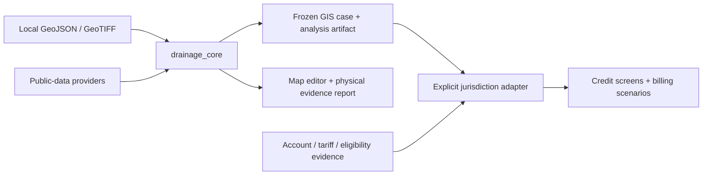

# Independent GIS and jurisdiction policy layers

## Physical GIS layer

`drainage_core` implements geometry, native-grid terrain preparation, roof/ground
classification accounting, canopy overlays, barriers, known inlets/connections,
contributing terminal regions, source-quality checks, validation, persistence,
map editing and GIS reports. It has no dependency on `stormwater`, a jurisdiction,
tariff or account. The CLI, reports and local server work when every import of
`stormwater` is blocked; a fresh-process regression verifies that boundary.

No city-specific projected CRS is a default. The file importer uses the DEM's
native CRS, or selects a suitable UTM zone from the boundary when terrain is
absent. Polar regions require an explicit projected CRS. Area output provides
square metres and square feet; a separate local area-accounting CRS can be
preserved when vectors are aligned to a native terrain grid.

Public-data retrieval remains a provider concern. Generic file inputs do not
require a city API. Shared cache, ArcGIS pagination and source diagnostics live
in `drainage_core.sources`; Philadelphia acquisition URLs and parcel resolution
stay in `stormwater.acquisition`.

Current physics remains topographic D8 screening and explicit urban conveyance,
not rainfall/runoff hydrographs, hydraulic pipe-capacity modeling, earthworks
sequencing or construction design certification. Construction/condition features
and dates remain evidence inputs with unknowns preserved.

## Saved contract

`drainage_core.engine.analyze(case)` returns a versioned `gis-analysis` artifact:

- Input SHA-256, stable analysis-content digest and engine version.
- Physical surface measurements, unknown area and supporting geometries.
- Terrain routing, terminal-region/IA intersections and unresolved connections.
- Source-quality issues, assumptions and separate IA/drainage validation.
- Map features, calculation time and logged manual review.

It returns no billing, credit screens, eligibility decisions or monetary savings.
`ProjectStore(directory)` writes `case.json`, `analysis.json`, `report.html` and
`measurements.geojson` directly in that directory; input revisions remain
immutable. An input hash changes with source metadata and corrections. The
analysis digest excludes elapsed time so identical evidence has stable content
identity. Digests establish reproducibility, not independent accuracy or approval.

## Jurisdiction policy layer

The first profile is `stormwater.jurisdictions.philadelphia`, explicitly selected
as `philadelphia-pwd`. Its `apply(case, gis_result, policy_inputs=None)` operation
consumes frozen GIS evidence and account/benefit/tariff inputs. It checks that the
case and artifact match, verifies the artifact digest, and returns only the policy
enrichment with GIS/policy hashes. Its spatial benefit allocation checks use
measured geometry without rerouting or reclassifying it. Changing only the policy
file leaves physical analysis unchanged.

Only Philadelphia policy is implemented. Other locations can use GIS immediately;
their credit rules need an explicit profile with their own tests and source
verification. The module contract is documented in [JURISDICTIONS.md](JURISDICTIONS.md).

## Compatibility

The existing Philadelphia app remains on its original entry point and port. Its
`stormwater.cases` orchestrator now composes the GIS engine with the PWD adapter,
and saves a separate `gis-analysis.json` alongside its combined `analysis.json`.
That independent artifact can be passed to `./credits` without rerunning GIS.
Old imports of geometry/raster/routing remain compatibility shims; the real
implementations live only in `drainage_core`.

The GIS and Philadelphia apps share map/editor assets and HTTP interaction
conventions. The GIS server has no provider-acquisition or policy endpoints.
GIS mode supports local boundary/features/raster imports, native-DEM alignment,
replayable corrections, save/reopen and physical exports. It starts no browser.

## Verification and remaining limits

The suite retains the original calculation and pipeline checks, adding import
isolation, international metric/foot fixtures, southern-hemisphere operation,
standalone CLI/HTTP workflow, artifact immutability, stale/tampered artifact
rejection and policy-only reuse. A built wheel was installed into a temporary
target and successfully ran the Sydney example outside the checkout under the
same jurisdiction-import blocker, with bundled map assets present.

The real Whitaker policy-only command preserved case/GIS/DEM/metadata hashes and
reproduced the $3,138.21 standard public baseline. Its physical area and routing
outputs remain unchanged. Existing empirical-validation, site-evidence and
billing limitations remain; browser pointer/visual behavior is still unverified
without an isolated browser. No personal Chrome was used.
